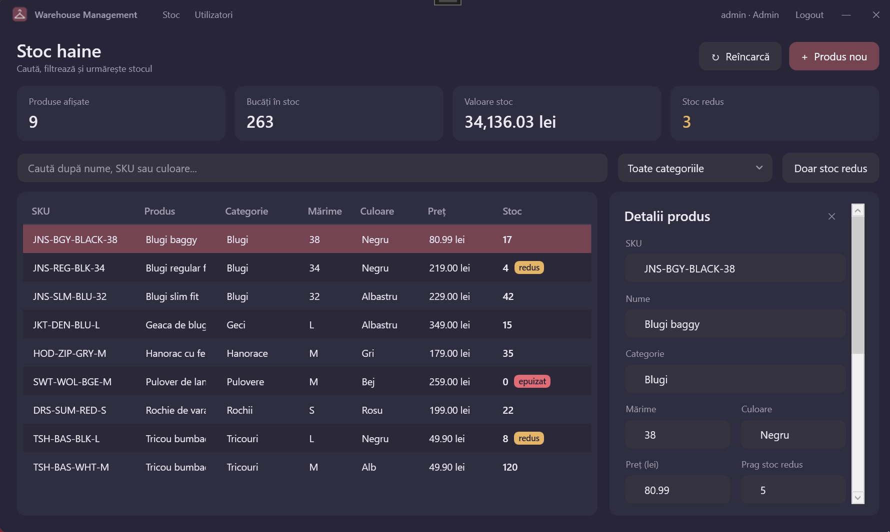
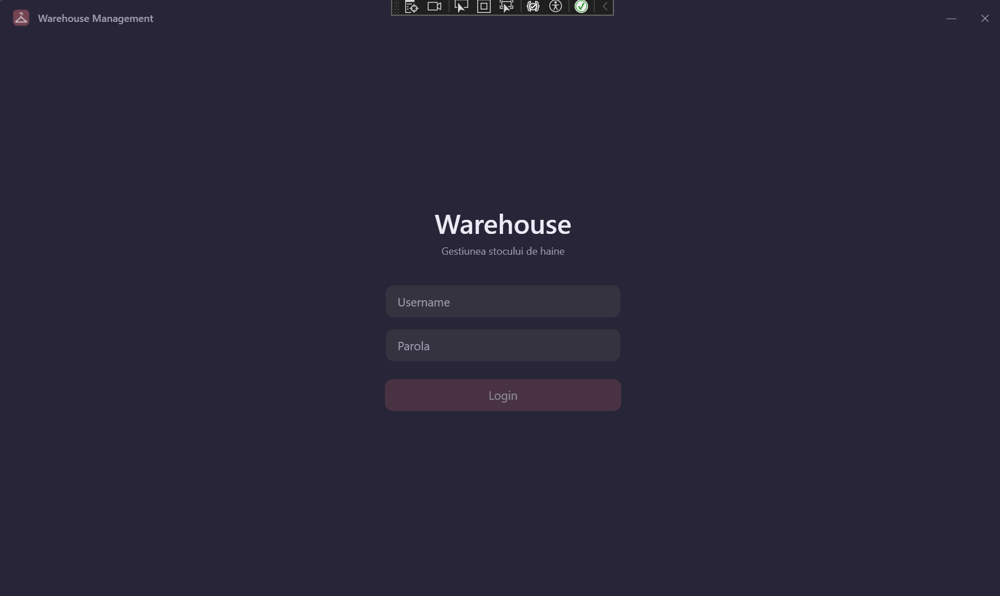
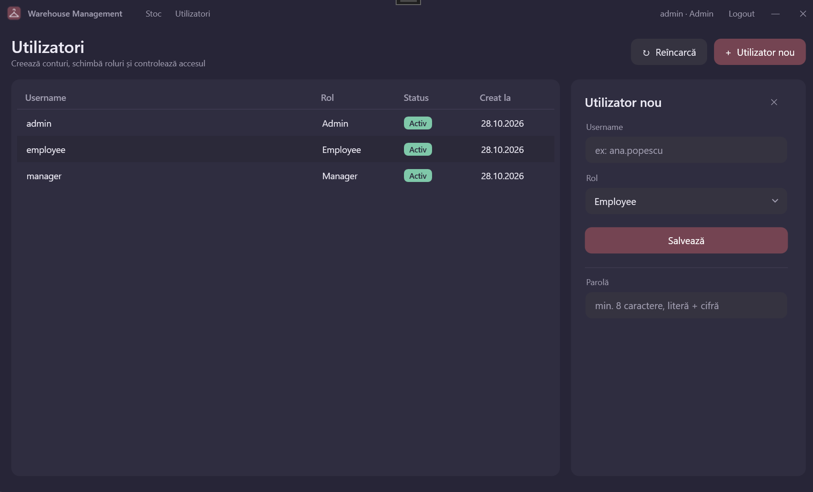

# 👕 Warehouse Management

Aplicație desktop pentru **gestiunea stocului de haine** dintr-un depozit: produse, cantități, intrări și ieșiri de marfă, istoric complet și conturi de utilizator pe roluri.

Construită cu **WPF (.NET 9)** pe client, **ASP.NET Core Web API** pe server și **MySQL** ca bază de date.

<p align="center">
  
</p>

---

## Funcționalități

- **Login securizat:** parole hash-uite cu PBKDF2 și sesiune pe bază de token **JWT**.
- **Roluri:** Admin, Manager, Employee, fiecare cu propriile drepturi.
- **Stoc în timp real:** carduri cu totaluri (produse, bucăți, valoarea stocului, câte au stoc redus).
- **Căutare** după nume, SKU sau culoare, cu actualizare automată în timp ce scrii.
- **Filtre** pe categorie și „doar stoc redus”.
- **Etichete vizuale:** *redus* (galben) și *epuizat* (roșu).
- **Produse:** adăugare, editare, ștergere.
- **Intrări / ieșiri de marfă** cu motiv. Stocul nu poate ajunge niciodată negativ, nici când doi utilizatori scot ultima bucată în același timp.
- **Istoric complet:** cine, când, cât și de ce pentru fiecare mișcare de stoc.
- **Administrare utilizatori:** creare conturi, schimbare rol, dezactivare, resetare parolă.

## Roluri și permisiuni

| Acțiune | Employee | Manager | Admin |
|---|:---:|:---:|:---:|
| Vizualizare stoc, căutare, filtre | ✅ | ✅ | ✅ |
| Intrări / ieșiri de marfă | ✅ | ✅ | ✅ |
| Adăugare și editare produse | ❌ | ✅ | ✅ |
| Ștergere produse | ❌ | ❌ | ✅ |
| Administrare utilizatori | ❌ | ❌ | ✅ |

Permisiunile sunt verificate **pe server** (politici de autorizare). Clientul doar ascunde butoanele pe care utilizatorul nu are voie să le folosească.

## Tehnologii

| Zonă | Tehnologie |
|---|---|
| Client | WPF, .NET 9, MVVM cu **CommunityToolkit.Mvvm**, Generic Host + Dependency Injection, `HttpClient` tipizat |
| Server | ASP.NET Core 9 **Minimal APIs**, JWT Bearer, ProblemDetails, OpenAPI |
| Date | **MySQL 8.4**, Entity Framework Core 9 + Pomelo, migrări |
| Securitate | `PasswordHasher` (PBKDF2), JWT, politici pe roluri, User Secrets |

## Arhitectură

```
┌────────────────────┐   HTTPS + JSON (JWT)   ┌──────────────────────┐   EF Core   ┌─────────┐
│  InventoryClient   │ ─────────────────────► │   InventoryServer    │ ──────────► │  MySQL  │
│  (WPF, MVVM)       │ ◄───────────────────── │   (ASP.NET Core API) │ ◄────────── │         │
└────────────────────┘                        └──────────────────────┘             └─────────┘
          │                                              │
          └──────────── InventoryCommon (DTO-uri) ───────┘
```

- **InventoryCommon**: contractele (DTO-urile) comune clientului și serverului.
- **InventoryServer**: logica de business, validarea, autorizarea și accesul la baza de date.
- **InventoryClient**: interfața. Nu se conectează direct la baza de date, ci doar la API.

## Rulare locală

### 1. Cerințe

- **Visual Studio 2022** cu workload-urile *ASP.NET and web development* și *.NET desktop development*
- **.NET 9 SDK**
- **MySQL Server 8.4**

### 2. Baza de date

În MySQL (Workbench sau linie de comandă):

```sql
CREATE DATABASE inventory_db CHARACTER SET utf8mb4 COLLATE utf8mb4_0900_ai_ci;
CREATE USER 'inventory'@'localhost' IDENTIFIED BY 'parola-ta';
GRANT ALL PRIVILEGES ON inventory_db.* TO 'inventory'@'localhost';
FLUSH PRIVILEGES;
```

### 3. Secretele serverului

Click dreapta pe **InventoryServer** → **Manage User Secrets** și completează:

```json
{
  "ConnectionStrings": {
    "Inventory": "Server=localhost;Port=3306;Database=inventory_db;User=inventory;Password=parola-ta"
  },
  "Jwt": {
    "SigningKey": "o-cheie-lunga-de-minim-32-de-caractere"
  },
  "Seed": {
    "DefaultPassword": "Parola123!"
  }
}
```

Secretele stau în afara proiectului și **nu ajung pe GitHub**.

### 4. Pornire

1. Deschide `WarehouseManagement.sln`.
2. Click dreapta pe soluție → **Configure Startup Projects** → **Multiple**: `InventoryServer` și `InventoryClient` pe **Start**.
3. Apasă **F5**.

La prima pornire, serverul aplică automat migrările și creează **date de test**: 3 utilizatori și 8 produse.

| Utilizator | Rol | Parolă |
|---|---|---|
| `admin` | Admin | valoarea din `Seed:DefaultPassword` |
| `manager` | Manager | la fel |
| `employee` | Employee | la fel |

## API

| Metodă | Rută | Acces |
|---|---|---|
| `POST` | `/api/auth/login` | public |
| `GET` | `/api/auth/me` | autentificat |
| `GET` | `/api/products?search=&category=&lowStockOnly=` | autentificat |
| `GET` | `/api/products/categories` | autentificat |
| `GET` | `/api/products/{id}` | autentificat |
| `POST` | `/api/products` | Admin, Manager |
| `PUT` | `/api/products/{id}` | Admin, Manager |
| `DELETE` | `/api/products/{id}` | Admin |
| `POST` | `/api/products/{id}/stock` | autentificat |
| `GET` | `/api/products/{id}/movements` | autentificat |
| `GET` / `POST` | `/api/users` | Admin |
| `PUT` | `/api/users/{id}` | Admin |
| `POST` | `/api/users/{id}/reset-password` | Admin |

Exemple gata de rulat se află în `InventoryServer/InventoryServer.http`. Documentul OpenAPI e disponibil în Development la `/openapi/v1.json`.

## Structura proiectului

```
WarehouseManagement/
├── InventoryCommon/          # DTO-uri și enum-uri comune
│   └── Contracts/
├── InventoryServer/          # Web API
│   ├── Data/                 # DbContext, entități, migrări, seeding
│   ├── Features/             # Auth, Products, Users (endpoint-uri pe funcționalități)
│   └── Security/             # JWT, politici, extensii
└── InventoryClient/          # Aplicația WPF
    ├── Services/             # ApiClient, sesiune, navigare
    ├── ViewModels/           # Logica ecranelor (MVVM)
    ├── Views/                # Ecranele (XAML)
    ├── Themes/               # Culori și stiluri
    └── Helpers/
```

## Capturi de ecran

| Login | Utilizatori |
|---|---|
|  |  |

## Decizii de design

- **Cantitatea nu se editează direct.** Se schimbă doar prin intrări/ieșiri, ca fiecare modificare să rămână în istoric.
- **Utilizatorii nu se șterg, se dezactivează.** Istoricul de stoc păstrează cine a făcut fiecare mișcare.
- **Un admin nu își poate schimba propriul rol** și nici nu își poate dezactiva contul, ca să nu rămână aplicația fără administrator.
- **Scăderea stocului e atomică** (un singur `UPDATE ... WHERE Quantity + delta >= 0`), deci nu există curse între utilizatori.

## Idei pentru viitor

- Export al stocului în Excel
- Teste automate (xUnit) pentru server
- Grafice cu evoluția stocului
- Notificări pentru stoc redus
